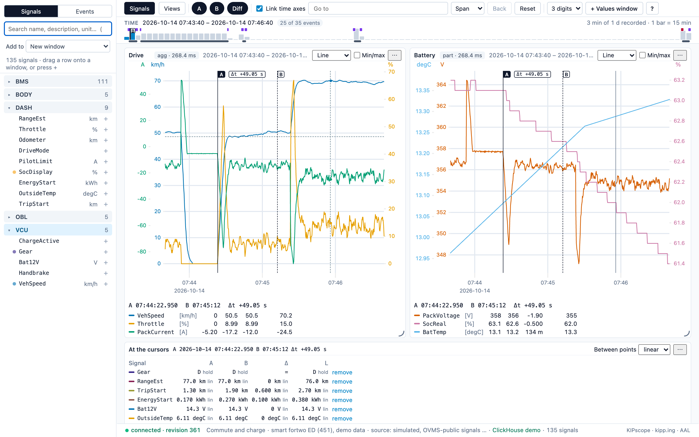
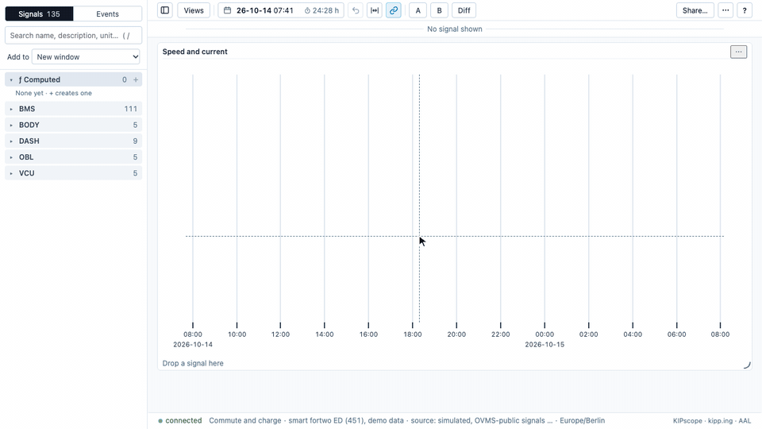
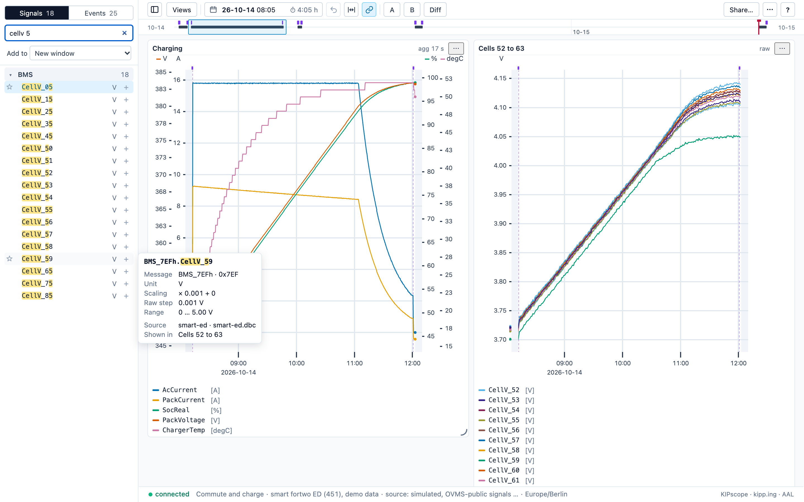
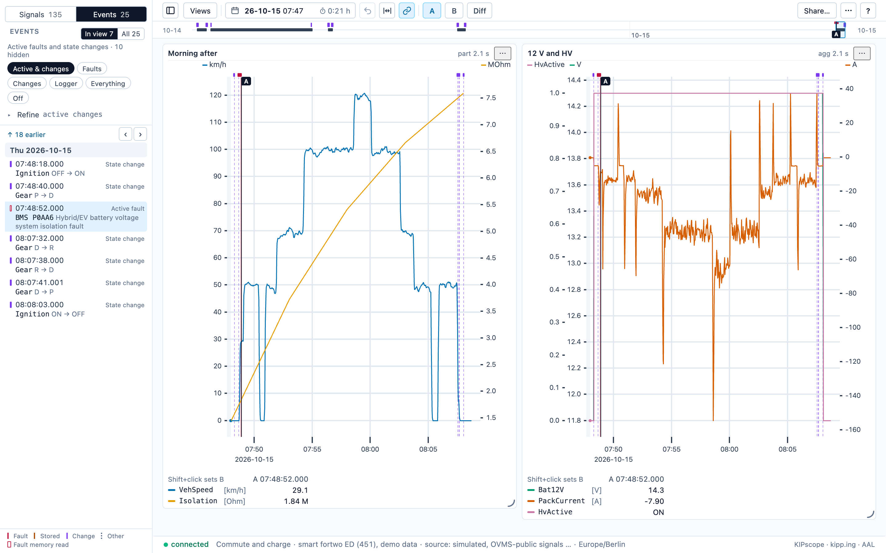
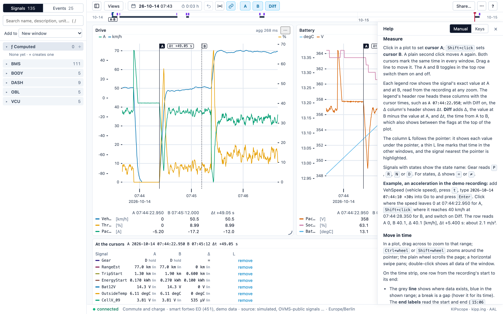

# KIPscope

**A fast, scriptable scope for recorded vehicle data.** Search CAN bus signals and diagnostic readings, lay them out in linked chart windows, zoom from a whole recording down to single samples, and read exact values and differences with two cursors. Everything in the UI is also a command, so a CLI or an AI agent can drive the same workspace. The data stays where it is: ClickHouse, Azure Data Explorer or any source behind a small adapter.

**v0.1.0** · [What's in it](CHANGELOG.md) · [Try the demo](#demo) · [Manual](docs/manual.md) · [License](#license)



<sub>All pictures show the [demo recording](#demo): simulated data of a smart fortwo electric drive (451), limited to signals the [Open Vehicle Monitoring System](https://github.com/openvehicles/Open-Vehicle-Monitoring-System-3) decodes publicly, with made-up message names and generic SAE fault codes.</sub>

## Why KIPscope

My own car is a smart fortwo electric drive (451). It used to report through an [OVMS](https://github.com/openvehicles/Open-Vehicle-Monitoring-System-3) module; today a self-built ESP32 logger [ESPCars](https://github.com/kipp-ing/ESPCars)  records its CAN bus and diagnostic readings into ClickHouse. What was missing was a way to look at those recordings the way engineers do with CANalyzer or CANape, and their licences are far out of reach for a private car.

So I built one. KIPscope is a private project, built with a small team of AI agents through spec-driven rounds [(OpenSpec)](https://github.com/Fission-AI/OpenSpec): [how that worked](docs/agentic-coding.md).

It paid off on the first real recordings: KIPscope shows that something is wrong with some of my smart's battery cells. The [charging picture](#what-it-does) shows that kind of view on simulated demo data: twelve cell voltages over a charge, one of them lagging.

## What it does

- **Find signals fast.** Ranked search over name, short name, description and unit; the explorer groups signals by sending ECU. A hover card shows what the DBC knows: message, CAN ID, scaling, range, SNA codes, states.
- **Drag to chart.** Drop a signal on a window to add it, on free space for a new window; up to four units per window, one y axis each. Drag a legend row to move a signal, hold Alt or Ctrl to copy it.
- **Zoom without waiting.** Raw samples or min/mean/max buckets by zoom level, cached tiles, linked time axes; tested on 10 h at 5 ms.
- **Measure exactly.** Cursors A and B in every window; each legend row shows the exact value at A and at B, Diff adds Δ and Δt; L follows the pointer. A values window lists many signals at the cursors.
- **See the whole recording.** The TIME strip shows data density and drives; click a drive to fit it, drag to zoom, step with `,` and `.`.
- **Events in context.** Fault memory reads (DTCs), state changes and logger notes as pins on the strip and lines in the plots, with a filter and an Events tab.
- **Honest gaps.** SNA values are never drawn; logger gaps break the lines and show as grey bands.
- **Scriptable.** Every UI action is a workspace command; `kipscope` drives it from the shell, `--wait` until the UI rendered it. Saved views, YAML export and `#view=` links.
- **Step through found sessions.** An external search tool hands over a list of sessions (drives, charges, idle times); `[` and `]` step through them with the layout kept and aligned to an event, Unlink shows the vehicle's whole recording.
- **Pluggable data sources.** Adapters for ClickHouse and Azure Data Explorer ship; another source is one adapter module with seven required methods and a conformance suite ([docs/data-sources.md](docs/data-sources.md)).
- **Runs as a team server.** One shared server with enterprise SSO (OIDC), rights from a signed handoff, sharing that never widens access and bounded queries on large tables ([below](#runs-as-a-team-server)).



| | |
|---|---|
|  |  |
| **Charging.** Charger and pack values over a 4 h AC charge; twelve cells, the weakest one stays behind. Hover card of a signal in the explorer. | **Events.** The Events tab with state changes and an active fault; the isolation reading recovers during the drive. |
|  | |
| **Help.** `?` opens the manual ([docs/manual.md](docs/manual.md)) and all keys. | |

## Demo

Try KIPscope without a vehicle: two days of a simulated smart fortwo electric drive (four drives, one AC charge, a fault memory read; 2.5 M rows, 135 signals). The signals are the ones OVMS decodes publicly for this car (module `vehicle_smarted`): speed, throttle, gear, doors, ignition, pack voltage and current, state of charge, range, odometer, 12 V, outside temperature, charge state, the polled cell voltages and temperatures, and the on-board charger. Message and signal names in [demo/smart-ed.dbc](demo/smart-ed.dbc) are made up; the fault codes are generic SAE J2012 codes.

```sh
pnpm install
docker compose up -d                          # local ClickHouse on 127.0.0.1:8124
pnpm --filter @kipscope/server seed:demo      # database `demo`, about 10 s
scripts/demo.sh                               # UI http://localhost:5183, server 7320
```

`scripts/demo.sh` uses [demo/kipscope.yaml](demo/kipscope.yaml) and keeps its workspace in `.kipscope-demo/`, so a dev server on 7310/5173 keeps running. The CLI reaches it with `KIPSCOPE_URL=http://127.0.0.1:7320`. `node scripts/capture.mjs` remakes the pictures in [docs/images/](docs/images/) from the running demo (headless Chrome, ffmpeg for the GIF; it changes the demo workspace).

## Docs

| What | Where |
|---|---|
| Manual (also in the app, `?`) | [docs/manual.md](docs/manual.md) |
| Data sources and adapters | [docs/data-sources.md](docs/data-sources.md) |
| HTTP API | [docs/http-api.md](docs/http-api.md) |
| What's new per version | [CHANGELOG.md](CHANGELOG.md) |
| KIPscope as a team server: overview, security model, setup | [docs/corporate.md](docs/corporate.md) |
| Server deployment: sign-in (OIDC), rights, workspaces | [docs/deploy.md](docs/deploy.md) |
| Handoff from a search tool: catalog, signature, link | [docs/handoff.md](docs/handoff.md) |
| Requirements (German) | [docs/concept.md](docs/concept.md) |
| Specs, one per capability | [openspec/specs/](openspec/specs/) |
| Changes in flight and archived | [openspec/changes/](openspec/changes/) |
| Decisions | [docs/decisions.md](docs/decisions.md) |
| State and next steps | [docs/status.md](docs/status.md) |
| Team roles and round flow | [docs/team.md](docs/team.md) |
| How it was built with an agent team, and how to reuse that | [docs/agentic-coding.md](docs/agentic-coding.md) |

## Layout

| Path | Contents |
|---|---|
| `packages/shared` | Workspace model and commands (`apply.ts`), series encoding, cursor evaluation, number and time formats; used by all three apps |
| `apps/server` | HTTP API on port 7310: signal catalog from the DBC, resolution-aware series queries, cursor values, the workspace and its live channel |
| `apps/web` | React + uPlot UI on port 5173 |
| `apps/cli` | `kipscope` command line, see [CLI](#cli) |
| `demo` | DBC and project file of the [demo](#demo) |

## Setup

Requires Node ≥ 22.18, pnpm 10, Docker.

```sh
pnpm install
cp .env.example .env                    # then set the source, see Data sources
cp kipscope.example.yaml kipscope.yaml  # optional: names, groups, measurement, events for your DBC
```

`.env` and `kipscope.yaml` are local and gitignored: the rules for a real vehicle's DBC stay out of the repo.

## Data sources

The server reads one source through an adapter: ClickHouse (default), Azure Data Explorer (`KIPSCOPE_SOURCE=adx`) or your own; the adapter contract, every variable and "Connect your ADX" are in [docs/data-sources.md](docs/data-sources.md), the HTTP routes in [docs/http-api.md](docs/http-api.md).

**Real data (development):** ClickHouse `sdlog` on carserver (read-only user `letsview`, password in `.env` as `CLICKHOUSE_PASSWORD`), reachable only through an SSH tunnel:

```sh
scripts/tunnel.sh start    # keeps the tunnel up and reconnects within ~5 s after a drop (e.g. carserver's 23:00 reboot)
scripts/tunnel.sh status   # keeper running? ClickHouse answering on 18123?
scripts/tunnel.sh stop
```

The keeper runs `ssh -N -L 18123:localhost:8123 jan@192.168.42.207` in a loop (host: `KIPSCOPE_TUNNEL_HOST`); log in `$TMPDIR/kipscope-tunnel.log`.

**Test database (automated tests):** local ClickHouse with synthetic data:

```sh
docker compose up -d
pnpm --filter @kipscope/server seed:test
```

The seed scripts (`seed:test`, `seed:demo`) refuse to run if their URL and `CLICKHOUSE_URL` name the same host and port (`localhost`, `127.0.0.1` and `[::1]` count as one host).

**ADX test (Kusto emulator, opt-in):** under the compose profile `adx` on `127.0.0.1:8125`; `pnpm test` does not need it:

```sh
docker compose --profile adx up -d
pnpm --filter @kipscope/server seed:adx   # refuses a non-loopback TEST_ADX_URL
pnpm --filter @kipscope/server test:adx   # ADX conformance and adapter tests
```

## Run

```sh
pnpm --filter @kipscope/server dev   # server
pnpm --filter @kipscope/web dev      # UI at http://localhost:5173, proxies /api to the server
```

The UI's dev server proxies `/api` and the live channel to `KIPSCOPE_SERVER_URL` (default `http://127.0.0.1:7310`).

**Scoped by default:** the server starts with `KIPSCOPE_CATALOG=scoped` and reads nothing until a workspace has a scope, one data ref and a time window (KIPscope never scans a source's whole data, D-117). A workspace without a scope shows the **Scope card** above its windows, prefilled from them: check data ref, From and To and click **Set scope**. From the CLI (`kipscope` is `node apps/cli/src/main.ts`, section [CLI](#cli)):

```sh
kipscope scope set smart451 2026-10-27T00:00:00Z 2026-10-28T00:00:00Z
# or sessions: one per drive, found one UTC day at a time (at most 32 days)
kipscope case drives smart451 2026-10-20T00:00:00Z 2026-10-28T00:00:00Z > drives.json
kipscope case open drives.json
```

Once your latest workspace has a scope, `kipscope case drives` without `--workspace` is bound to that scope and answers `out_of_scope`; run it before setting a scope, or pass `--workspace ID` of a workspace without a scope.

Every scan is bounded: a range over `KIPSCOPE_SCAN_SPAN` (default `7d`) or holding more than `KIPSCOPE_SCAN_ROWS` rows (default `150000000`, one full smart451 day fits) answers `too wide: …; choose a shorter range` instead of timing out. `KIPSCOPE_CATALOG=full` (a start-up catalog of every data ref) is for small sources such as the test DB; [docs/data-sources.md](docs/data-sources.md#scope) has the details.

`pnpm smoke` is the crash gate: it loads the running UI in its own headless Chrome (fresh temp profile), clicks through every top-level part at 1440×900 and 1000×557 and fails on a Vite error overlay, uncaught exceptions, console errors or failed module loads; an API answer the specs expect (404 `unknown_signal` for a signal a session lacks) is not a console error. `--url <url>` checks another page, `--preview` the built `apps/web/dist` via `vite preview`. It creates its own scoped workspace (`POST /api/workspaces {open: {view}}`, sent by the script) with `--scope REF FROM TO` (default `smart451 2026-10-27T00:00:00Z 2026-10-28T00:00:00Z`) and one timeseries window of `--signal ID` (default `smart451/BMS.cell_voltage_max`) over 10:00–11:00Z, opens it at `/w/<id>`, blocks every write the page sends to `/api`, and deletes the workspace on every exit path, so it never changes yours. It prints the IDs it created and deleted.

The server answers only requests whose `Host` names `localhost`, `127.0.0.1` or `[::1]` (or a non-loopback `KIPSCOPE_HOST`, or a host of `KIPSCOPE_ORIGINS`) and whose `Origin`, if any, is such a host; other requests get 403. Locally there is no login (`KIPSCOPE_IDENTITY=none`, the default): every request is the user `local`, every workspace sees all data, and a non-loopback `KIPSCOPE_HOST` logs a warning at start.

**Workspaces:** each tab works in a workspace with its own address `/w/<id>` (old `/s/<id>` addresses still open); `/` reuses your latest workspace that no tab has open (or makes a new one), so two tabs never mirror each other, and a `#view=` or `?view=` link opens the view in a new workspace, so old tabs keep their case. `Share…` in the top row copies a link (own copy, or the same live workspace) and sets who else may open it; the Views menu lists your recent workspaces. The CLI and scripts without `--workspace` use the latest one. On first start older state dirs are migrated to the user `local` (the folder of round 1 becomes `workspaces/`, `workspace.json` becomes a workspace, `views/` moves to `users/local/views/`).

**Sessions from a search tool:** a catalog of sessions opens as a link `/open#cases=<code>`, a file (`kipscope case open FILE`, or dropped on the window) or `POST /api/workspaces {open: {cases}}`, in a new workspace with the session bar. Locally an unsigned catalog is enough; to try it on your own recording, `kipscope case drives <dataRef> FROM TO > drives.json` then `kipscope case open drives.json` makes one session per drive. A shared server with sign-in and signed catalogs: [Runs as a team server](#runs-as-a-team-server).

Besides the workspace API the server answers `GET /api/meta` (data source and whether it answers, catalog state, build commit; never the source address or credentials) and `GET /api/license` (the repo's `LICENSE` as text). The UI's footer reads both.

## Using the app

The [manual](docs/manual.md) explains every part; `?` in the app shows it and all keys. In short:

**Signals.** The sidebar searches the catalog (`/` focuses it, `s` toggles the sidebar). Arrow keys and Enter, or a row's `+` button, add a signal to the marked window (click a window to mark it), or to a new one. Drag a signal from the sidebar or a legend row onto a window to add or move it; hold Alt or Ctrl to copy. A window takes up to four units, one y axis each. A window emptied by a move disappears. Hover a legend row and click its `×` to remove the signal.

**Time.** With the time axes linked (default), every window follows.

| Do | Effect |
|---|---|
| Drag across a plot | zoom to that range |
| Ctrl/Shift + wheel, trackpad pinch | zoom at the pointer |
| Horizontal wheel or swipe | pan |
| Plain vertical wheel | scrolls the page, never the chart |
| `+` / `-` | zoom in / out around cursor A when it is in view, else the centre |
| `←` / `→`, Shift+`←` / `→` | pan by half / a whole span |
| `t`, or the range button | open the range picker: a calendar with the data per day, presets, From/To, or type into "Go to": `15:08`, `15:07 .. 15:09`, `15:08 ±30s`, `a..b`, `1h`, `+10min` |
| Backspace, "Back" | previous range |
| Double-click, `Home`, "Reset" | the signals' full extent |
| TIME strip | click jumps, drag zooms, click a drive fits it, `,` / `.` step drives |

**Cursors.** Click a plot to place cursor A, Shift+click for B, drag a line to move it (Esc puts it back). Each legend row shows the exact value at A and at B; "Diff" adds Δ = B − A and Δt. Hover a value for its kind (linear between points, held, …). A values window ("+ Values window") lists many signals at the cursors without a plot.

**Events.** The Events tab (`e`) lists faults and state changes with one filter string (default `active changes`); `n` / `p` put cursor A on the next or previous event.

## Display names

The UI shows short signal names from the project file `kipscope.yaml` in the repo root (local and gitignored; start from [kipscope.example.yaml](kipscope.example.yaml), which explains every key). The demo's [demo/kipscope.yaml](demo/kipscope.yaml) shortens every name to the part after the message:

```yaml
display:
  names:
    - match: '^(?<message>[^.]+?)_[0-9A-Fa-f]+h\.(?<signal>.+)$'   # VEH_200h.VehSpeed -> VehSpeed
      show: '{signal}'
      collision: '{signal} ({message})'
```

| Key | Meaning |
|---|---|
| `match` | JavaScript RegExp (no flags) on the full source name without data reference; its named groups feed the templates |
| `show` | Shown name, `{group}` inserts a named group; renders empty → full name |
| `collision` | Optional; used instead of `show` when different signals would show the same name (`VehSpeed (VEH)`) |
| `rename` | Map full source name → shown name (`VEH_200h.VehSpeed: Speed`) |

- Rules run in order, the first whose `match` finds the name wins; no match shows the full name.
- `rename` beats every rule and gets no collision suffix.
- Collisions are checked over the whole catalog: rule-made names take their `collision` suffix; names still shared fall back to the full name (logged as `warn`).
- Only the UI changes: explorer, legend, values window and drag ghost show the short name; hover card and name tooltips show the full name; search matches short name, message and full name. IDs, API, CLI and workspace keep full names.
- `KIPSCOPE_PROJECT_FILE` points to another file (relative to the repo root); it must then exist. Without it a missing `kipscope.yaml` means full names.
- Restart the server after editing the file. An invalid file (YAML syntax, unknown key, bad regex, unknown group in a template) stops the server with one line per problem.

### Diagnostic catalogs

Decoded diagnostic readings (`BMS.soc`, `BMS.cell_voltage.001`, …) have no DBC entry. `KIPSCOPE_DIAG_CATALOGS` lists the decoder's `.manifest.json` files (comma-separated, relative to the repo root); the names file `<name>.names.toml` next to each manifest maps fields to signal names as the decoder does. Each matching signal gets its unit, kind and state names from the catalog, so readings with one unit share an axis. A DBC entry wins over a catalog, an earlier catalog over a later one (one warning per load). A broken manifest is skipped and a missing names file falls back to catalog names, each with a warning; the server always starts. Both files are read on every catalog load. Invalid sentinels are carried but never treated as SNA (D-061).

### Signal groups

`display.groups` sorts the explorer into collapsible groups. Grouping by sending ECU takes the transmitter of the signal's `BO_` line in the DBC; a second rule can take a name prefix where the DBC names no sender:

```yaml
display:
  groups:
    - group: '{sender}'               # BO_ 512 VEH_200h: 8 VCU -> VCU
    - match: '^(?<ecu>BMS|OBL)_'      # fallback for messages without a sender
      group: '{ecu}'
```

| Key | Meaning |
|---|---|
| `match` | Optional JavaScript RegExp (no flags) on the full source name; its named groups feed `group`. Absent → the rule applies to every signal |
| `group` | Group name; `{sender}` inserts the DBC sender (blank for `Vector__XXX` or without DBC entry), `{ecu}` a named group of `match` (none may be called `sender`) |

- Rules run in order; the first rule that matches and renders non-blank wins. Unlike `names`, a blank render (no sender) falls through to the next rule.
- Signals no rule names go to `Other`, always last.
- Empty search: all groups collapsed, alphabetical. While searching: only groups with a hit, open, ordered by their best hit (`Other` still last); click a header or press Enter on it to toggle. Enter in the search adds the best hit, even when it sits in `Other` (D-115).
- Without `groups` the list is flat. Restart the server after editing the file.

### Measurement info

The optional `measurement` section of the same file gives the measurement info the footer shows at start (revision 0):

```yaml
measurement:
  name: Commute and charge             # ≤ 120 characters
  object: smart fortwo ED (451)        # ≤ 120 characters, the vehicle or device under test
  meta:                                # ≤ 8 entries, in file order
    driver: Jan                        # key ≤ 40 characters, starts with a letter; value ≤ 200 characters
```

CLI commands (`measurement …`, see [CLI](#cli)) change it while the server runs and win until the next restart; nothing writes the file back.

## Check

```sh
pnpm check   # all three below; exits non-zero on the first failure
pnpm build   # typecheck (+ web bundle)
pnpm test    # needs the seeded test database (see Data sources)
pnpm lint    # pnpm format to fix
```

## CLI

`kipscope` controls the open workspace through the server's HTTP API (spec [cli](openspec/specs/cli/spec.md); routes in [docs/http-api.md](docs/http-api.md), sources in [docs/data-sources.md](docs/data-sources.md)). Run it from the repo root while the server runs:

```sh
node apps/cli/src/main.ts --help
node apps/cli/src/main.ts state
```

Server: `--server URL` (an `http://` or `https://` URL, or a workspace link `<UI>/w/<id>`), else `KIPSCOPE_URL`, else `http://localhost:7310`. Workspace: `--workspace ID|LINK`, else `KIPSCOPE_WORKSPACE`, else the workspace of a link given as server; without one the call uses your latest workspace and keeps the one the first answer names (`X-KIPscope-Workspace`) for its later requests to `/api/w/<id>/…`; the output names it as `workspace`. A `--workspace` value that is neither an ID nor a link is a usage error. Token (on a server with sign-in, [docs/deploy.md](docs/deploy.md#cli-and-ai-callers)): `--token T`, else `KIPSCOPE_TOKEN`, else the output of `KIPSCOPE_TOKEN_COMMAND` (run once per call, 10 s timeout; a failure exits 2 with `token_command_failed`); sent as `Authorization: Bearer`, never printed. Global options anywhere on the line: `--wait` (block until an open UI of the same workspace rendered the command), `--timeout DURATION` (default `30s`), `--pretty`, `--help`; `--` ends options.

W is a window ID (`w3`), C is `a` or `b`. TIME is decimal ns, ISO-8601 with `Z`/`±HH:MM`, local wall time `YYYY-MM-DD[T ]HH:MM[:SS[.fffffffff]]` in the process's zone (`TZ`), or a cursor anchor `a`, `b+500ms`, `a-1s`. DURATION is `[+-]<number><unit>` with `ns us µs ms s min h`. SIGNAL is a full ID (`smart-ed/VEH_200h.VehSpeed`) or a unique bare name (`VehSpeed`); REF is an assignment ID (`a7`) or a signal in window W.

| Form | Command |
|---|---|
| `window create [--values] [--title T] [--from TIME --to TIME] [--mode line\|step\|markers] [--envelope on\|off]` | `window.create` |
| `window remove W` | `window.remove` |
| `window rename W TITLE` | `window.rename` (`""` clears) |
| `window height W PX` | `window.setHeight` |
| `window range W FROM TO` | `window.setRange` |
| `window display W [--mode M] [--envelope on\|off]` | `window.setDisplay` |
| `link on\|off` | `workspace.setLinkTime` |
| `signal add W SIGNAL` | `window.addSignal` |
| `signal remove W REF` | `window.removeSignal` |
| `signal move W REF TARGET\|new [--copy]` | `window.moveSignal` |
| `cursor set C TIME` | `cursor.set` |
| `cursor move C DURATION` | `cursor.move` |
| `cursor remove C` | `cursor.remove` |
| `diff on\|off` | `cursor.setDiff` |
| `digits 3\|4` | `workspace.setOptions {digits}`: significant digits of values in every UI of the workspace |
| `measurement name TEXT` | `measurement.set` name (`""` clears) |
| `measurement object TEXT` | `measurement.set` object (`""` clears) |
| `measurement meta KEY VALUE` | `measurement.setMeta` (`""` removes the entry) |
| `measurement clear` | `measurement.clear` |
| `events filter FILTER…` | `events.setFilter`: the filter of the events line and list (`""` for no filter words) |
| `events add SIGNAL` | `events.addSignal`: state changes of SIGNAL on the events line |
| `events remove SIGNAL` | `events.removeSignal` |
| `events list [FILTER…] [--ref DATAREF] [--from TIME --to TIME] [--table]` | `GET /api/events`: the events of DATAREF (default: that of the first signal shown) under FILTER (default: the workspace's); `--table` prints lines instead of JSON |
| `scope set REF FROM TO` | `scope.set`: bounds every query to data ref REF and `[FROM, TO)` (TIME rules, anchors included) |
| `scope widen` | one `scope.set` with the scope's span added on each side (2 h → 6 h); without a scope exit 1 `scope_required`, nothing sent |
| `scope clear` | `scope.clear` (refused with `KIPSCOPE_CATALOG=scoped`) |
| `case open FILE\|-` | `POST /api/workspaces {open: {cases}}` with the file's (or stdin's) catalog: a JWS, a link code, a catalog document, or a CLI output whose `data` is one; `local.url` is the new workspace's link |
| `case show` | the workspace's `case` (`data`), `local {position: "k / n", from, to}`; without a catalog exit 1 `no_case` |
| `case next` \| `case prev` | `case.step {by: 1 \| -1}`: the next or previous session in catalog order, windows kept at their offset |
| `case go N` | `case.go {index: N − 1}`: session N (1-based) |
| `case link [N]` | `case.go` to session N, default the current one: back from the whole vehicle to a session |
| `case unlink` | `case.unlink`: the scope becomes the span of the catalog's sessions of that vehicle (no source query) |
| `case align start\|end\|anchor` | `case.align`: what lines up between sessions |
| `case align event KIND SOURCE NAME [TEXT]` | `case.align` to the first matching event of each session |
| `case url FILE\|- [--trim]` | prints the link `<server>/open#cases=<code>` of a catalog; longer than 8,192 characters: exit 2 `link_too_long`; `--trim` drops sessions by the balanced trim of [handoff.md](docs/handoff.md) until it fits (unsigned catalogs only; `local.dropped`, `local.position`) |
| `case drives REF FROM TO` | prints a catalog with one session per drive of REF in `[FROM, TO)`, at most 32 days: one bounded density per UTC day, a too-wide day as four 6 h parts, drives touching at an edge merged (a test aid; `> drives.json`, then `case open drives.json`, or pipe it to `case open -`); exit 1 `no_data` without drives, `too_wide` when a 6 h part is still too wide |
| `command JSON` | the JSON as is (no anchors, names or REFs resolved) |
| `view save TITLE [--name N] [--note TEXT] [--overwrite]` | `POST /api/views`: saves the workspace as view N (default derived from TITLE); `data.view`, `revision` |
| `view open NAME` | `POST /api/views/open`: one command (`accepted`, `revision`, `data.report` of missing or left-out signals); honours `--wait` |
| `view delete NAME` | `DELETE /api/views/NAME` |
| `view import FILE [--name N] [--overwrite] [--open]` | `POST /api/views/import` with FILE's text (YAML or JSON, at most 256 KiB; an unreadable or larger FILE is a usage error) |
| `whoami` | `GET /api/me`: `data {user, identity, roles, canShare}` |
| `workspace list` | `GET /api/workspaces`: your workspaces, latest first |
| `workspace new` | `POST /api/workspaces`: a new empty workspace; `local.url` is its link `<server>/w/<id>` |
| `workspace share private\|read\|write` | `POST /api/workspaces/<id>/share` for the call's workspace (owner only; `read` and `write` need `KIPSCOPE_SHARE=on`) |
| `workspace delete ID` | `DELETE /api/workspaces/ID` |
| `fav list` | `GET /api/favourites`: your starred signal names, `data {names, error?}` (`error`: the file does not parse) |
| `fav add NAME…` | `POST /api/favourites {add}`: a full ID stars its name part; a bare NAME its one match in the workspace's list (several names: exit 1 `ambiguous_signal`, nothing sent); a NAME without match is stored as given with `data.warnings ["not in this list: NAME…"]`, exit 0; `data {names, added, warnings?}` and `workspace` |
| `fav rm NAME…` | `POST /api/favourites {remove}`: NAME is a favourite, one equal ignoring case or by its part after the first `.`, or a full ID whose name is one (`unknown_favourite`, `ambiguous_favourite`: exit 1, nothing sent); `data {names, removed}` |
| `calc list` | the workspace's computed signals, `data {computed: [{id, name, formula, unit?}]}` (formulas with full signal names) |
| `calc add FORMULA [--name NAME] [--unit UNIT]` | `computed.add`: FORMULA over up to 8 signals with numbers, `+ - * / ( )`, `abs(x)`, `min(x, y, …)`, `max(x, y, …)` (`"SIG_A - speed"`, `'abs("SIG_A − SPEED")'`); a name is a computed signal's name (ignoring case), a signal's full name, or its part after the first `.` when unique (ignoring case; several `ambiguous_signal` with `error.candidates`, none `unknown_signal`, a signal with states `not_numeric_signal`); names that are not identifiers in double quotes; stored with full names (`Fast_100h.SIG_A - Sna_800h.SPEED`); NAME defaults to the auto name (`SIG_A − SPEED`), UNIT to the inputs' unit where unambiguous; `created` the new ID (`c7`); any refusal (also `invalid_formula`) exits 1, nothing sent |
| `calc edit ID\|NAME [--formula F] [--name NAME] [--unit UNIT]` | `computed.update`: the stored definition with the given parts replaced (F resolved as in `calc add`; name and unit stay unless given); `created` the new ID; computed signals that use it get new IDs too |
| `calc rm ID\|NAME` | `computed.remove`; an ID from `calc list`, else a name ignoring case (none: exit 1 `unknown_computed`, nothing sent; used by another computed signal: exit 1 `computed_in_use`) |

Reads: `state`, `scope show` (`data {scope, catalog {mode, state, size}}`, `local {from, to}`), `search QUERY… [--limit N]`, `extent SIGNAL`, `value SIGNAL TIME [--mode line|step]` (a computed ID `<dataRef>/=c7` sends its definition's flattened `formula` from the workspace: nested computed signals replaced by their formulas), `wait [REVISION]`, `view list`, `view export NAME [--out FILE]` (prints the view's YAML text; with `--out` writes FILE and prints `data {name, path, bytes}`), `view link [--page URL]` (the `#view=` link of the open workspace that the UI's "Copy link (own copy)" gives, as `data {url, chars}`; `--page` is the UI page address, default the server address).

Each call prints one JSON line (`ok`, `outcome`, `exitCode`, and where they apply `workspace`, `accepted`, `command`, `revision`, `created`, `createdWindow`, `removedWindow`, `render`, `data`, `local`, `error`), except a successful `events list --table` and `view export NAME` without `--out`; a failure also prints one line to stderr. `local` holds times as local wall time with offset.

| Exit | Outcome | When |
|---|---|---|
| 0 | `ok` | read answered, or command accepted (with `--wait`: and rendered) |
| 1 | `rejected` | the server or a lookup refused it (`cursor_off`, `unknown_signal`, `ambiguous_signal`, `unauthenticated`, `forbidden_data`, `read_only`, …) |
| 2 | `usage` | arguments do not parse; nothing was sent |
| 3 | `unreachable` | no connection to the server |
| 4 | `timeout` | `--timeout` ran out during a request or the wait |
| 5 | `render_error` | the UI rendered with data errors |
| 6 | `no_ui` | waiting, and no UI connected for 2 s |
| 7 | `unavailable` | the server answered 5xx (e.g. `catalog_unavailable`, `identity_unavailable`) |

Examples, against the demo (window IDs come from `created`):

```sh
export KIPSCOPE_URL=http://127.0.0.1:7320
node apps/cli/src/main.ts --wait window create --title Launch --from "2026-10-14 07:44:10" --to "2026-10-14 07:44:40"
node apps/cli/src/main.ts signal add w1 VehSpeed
node apps/cli/src/main.ts cursor set a "2026-10-14 07:44:22.950"
node apps/cli/src/main.ts state | jq -r .local.cursors.a   # 2026-10-14 07:44:22.950+02:00
```

## Runs as a team server

Locally KIPscope is one user without a login. It also runs as one shared service: users need only a browser, the CLI and AI agents use the same API, and data, credentials and rights stay on the server. The overview with the picture, the security model and the setup steps is [docs/corporate.md](docs/corporate.md).

```
search tool ──signed link──▶ browser ──https──▶ TLS proxy (SSO) ──▶ KIPscope ──one service identity──▶ data source
   finds sessions,                                                   guard, grants,
   decides rights                                                    bounded queries
```

The search tool is a separate tool and not part of KIPscope; it is out of scope of this repo. KIPscope defines only the handoff interface (catalog, signature, link: [docs/handoff.md](docs/handoff.md)), so any search tool that signs a catalog works.

- **The search tool finds, KIPscope shows.** The search tool finds the sessions and hands over a catalog in any order, of any vehicles; KIPscope steps through it with the layout kept, preloads the neighbours and never scans a vehicle's whole history in one query, not even after Unlink.
- **Enterprise SSO (OIDC).** `KIPSCOPE_IDENTITY=oidc` validates JWT access tokens of any OIDC provider that publishes discovery and a JWKS, behind an OIDC proxy; any other sign-in plugs in as a small adapter module with a conformance suite. CLI and AI callers send a bearer token (`KIPSCOPE_TOKEN` or a token command).
- **Rights from the handoff.** On a server a new workspace sees nothing. Only a catalog signed by the search tool for the signed-in user widens its grant, by exactly the listed vehicles; roles decide nothing in KIPscope. One guard checks every route; a hidden vehicle and a missing one answer alike, and lists never show what the grant lacks.
- **Workspaces you don't manage.** Each tab is a workspace at `/w/<id>`. Share… sends an own copy or invites to the live workspace (read or write); sharing never widens data access, and `KIPSCOPE_SHARE=off` refuses new shares. Saved views are per user and grant nothing.
- **Large data.** Any source adapter, read with one service identity (for ADX a service principal or managed identity); scoped catalog for large tables, query classes that keep the UI first, and a measured 400-day vehicle with every query well under a second.
- **Local stays simple.** Without these variables (`KIPSCOPE_IDENTITY=none`) there is no login and one user sees everything.

| Topic | Guide |
|---|---|
| Overview, security model, setup checklist | [docs/corporate.md](docs/corporate.md) |
| Server, OIDC sign-in, own identity adapter, rights, trust boundary, service identity | [docs/deploy.md](docs/deploy.md) |
| For the search tool: catalog, signature, keys, link, errors | [docs/handoff.md](docs/handoff.md) |
| Sources: ClickHouse, ADX setup, own adapter, scoped catalog | [docs/data-sources.md](docs/data-sources.md) |

## License

[Attribution Assurance License](LICENSE) (SPDX `AAL`). © 2026 Jan Kipping, Agentic engineer · [kipp.ing](https://kipp.ing). The app shows `KIPscope · kipp.ing · AAL` in its footer (name and profession in the `kipp.ing` tooltip) and the full attribution at the end of `kipscope --help` and in the server start log. The GPG-signed license text is [LICENSE.asc](LICENSE.asc); verify with `gpg --import KEYS.asc && gpg --verify LICENSE.asc` (key `1E3BF6DE3CC6227749622E8EA53393CE9B74E4F7`).
