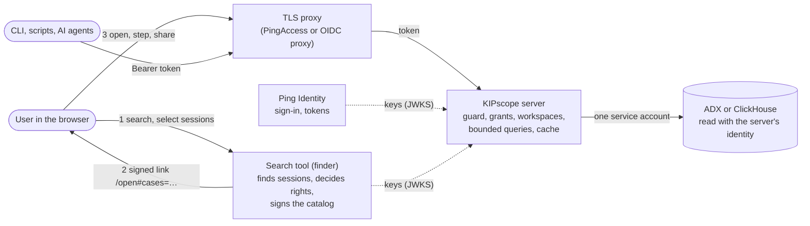

# KIPscope in a company

KIPscope is made to run as one shared service next to a search tool (finder) that finds sessions, with large recordings in Azure Data Explorer and sign-in through Ping Identity. Users need only a browser; credentials, queries and rights stay on the server. This page is the overview; the details are in [deploy.md](deploy.md) (server, sign-in, rights), [handoff.md](handoff.md) (the interface for the search tool) and [data-sources.md](data-sources.md) (ClickHouse, ADX). The search tool itself is not part of KIPscope and is out of scope here: KIPscope defines only the handoff interface (catalog, signature, link), and any search tool that signs a catalog works. Locally nothing of this is needed: with `KIPSCOPE_IDENTITY=none` (the default) one user sees everything, as before.

## The picture

## Who does what

| Part | Job | Never does |
|---|---|---|
| **Search tool** (finder; not part of KIPscope) | Finds sessions (drives, charges, idle times), decides which vehicles a user may see, signs a catalog of sessions for that user | Shows time series in detail |
| **Ping Identity** | Signs users and service accounts in; issues the access tokens KIPscope checks | Decides data rights in KIPscope |
| **TLS proxy** | Ends TLS, runs the browser sign-in, forwards the token | Exposes KIPscope's port to users |
| **KIPscope** | Shows one case at a time, fast; enforces the grant of each workspace on every route; keeps workspaces and views per user | Searches for sessions; stores rules of its own |
| **ADX** | Holds the recordings; KIPscope reads it with one service identity (Database Viewer) | Sees individual users |

## A day with it

1. In the search tool an engineer filters the fleet, for example every drive with a given fault, sorts the list as they like and clicks **Open in KIPscope**.
2. The search tool's server signs the list for this user and opens the link in the tab named `kipscope`; later clicks in the search tool reuse that tab.
3. KIPscope checks the signature and the user, widens the new workspace's grant by exactly the listed vehicles and shows the first session with the **session bar**: vehicle, kind, time, meta, `1 / 17`.
4. The engineer lays out the signals once, aligns the sessions to the fault event, and steps with `[` and `]` through all seventeen, across vehicles, in the search tool's order. Seen sessions and the preloaded neighbours draw from memory.
5. **Unlink** shows the current vehicle's whole recording, for as long as it reaches; Link goes back to the session.
6. **Share…** sends a colleague the workspace (read or write) or an own copy. The colleague sees the shared vehicles only inside that workspace.
7. A script or an AI agent does the same through the CLI with a service token: `kipscope case next`, `kipscope value …`, `--wait` until the UI drew it.

## Security model

- **Every request has a user.** The identity adapter (`oidc` for Ping-issued JWTs, or the company's own module) runs once per request in one guard, the live channel included. No token, no data (401).
- **Deny by default.** On a server a new workspace sees no data. Only a catalog signed by the configured finder, for the signed-in user (`sub`), with a short lifetime (`exp`), widens its grant, and only by the listed vehicles. No route, command, view or file can set a grant.
- **Rights are per vehicle, without time.** Whoever may see a vehicle may see all of it (D-086). Roles from the token are shown, they decide nothing in KIPscope: the finder decides.
- **No leaks.** A hidden vehicle and a missing one answer the same `403 forbidden_data`, before any lookup; lists, searches and counts never include data outside the grant; the workspace list never shows other users' workspaces.
- **Sharing never widens.** An invited user sees the shared workspace's grant only inside it; their own workspaces never gain it. `KIPSCOPE_SHARE=off` keeps every workspace private.
- **Links carry no credentials.** A forwarded catalog link does not open for anyone else; a view link (`#view=`) carries a layout, never a right.
- **Credentials stay on the server.** The browser and the CLI never see the database address or account; ADX is read with the server's service principal or managed identity.
- **The database is protected from the UI.** Every query is bounded by a data ref and a time window; nothing scans a vehicle's whole history in one go, not even after Unlink (D-082, D-086). Interactive queries go before background work (D-081).
- **Trust boundary.** Only the proxy reaches KIPscope's port; `KIPSCOPE_ORIGINS` refuses foreign pages and cross-site WebSockets ([deploy.md › Trust boundary](deploy.md#trust-boundary)).

## Fast on large data

- **Scoped catalog** (`KIPSCOPE_CATALOG=scoped`): no start-up scan of all vehicles; signal lists per case.
- **Resolution by zoom:** raw samples or min/mean/max buckets, so a year costs as many points as an hour.
- **Cache in the tab:** tiles stay across sessions; the next and previous sessions are preloaded in the background, and any gesture cancels that.
- **Measured** on a synthetic vehicle with 400 days and 57.6 M rows (2026-10-20, local Docker databases):

  | Query | ClickHouse | ADX emulator |
  |---|---|---|
  | Whole-vehicle extent | 148 ms | 75 ms |
  | Coarse density over the whole vehicle | 252 ms | 70 ms |
  | Vehicle signal list | 219 ms | 60 ms |
  | Series, 2,048 buckets | 60 ms | 164 ms |
  | Gaps, 32 days | 95 ms | 71 ms |
  | Events, 32 days | 4 ms | 7 ms |

  A real ADX cluster has not been measured yet.

## Setting it up

1. **ADX:** a service principal or managed identity with Database Viewer, logged in with `az login` as the user that runs KIPscope; tables in the default layout or a stored function ([data-sources.md › Connect your ADX](data-sources.md#connect-your-adx)).
2. **Server:** `pnpm build`, a `.env` with identity, origins, web and state dir, behind the TLS proxy on loopback ([deploy.md › Build and start](deploy.md#build-and-start)). Start on a fresh state dir.
3. **Ping:** `KIPSCOPE_IDENTITY=oidc` with issuer and audience; the browser through PingAccess or an OIDC proxy that forwards the token ([deploy.md › Ping Identity](deploy.md#ping-identity-with-oidc)). Another identity provider: an own adapter module with the conformance suite ([deploy.md › Your own adapter](deploy.md#your-own-adapter)).
4. **Finder keys:** the search tool publishes its public key set; KIPscope gets `KIPSCOPE_FINDER_JWKS`, `KIPSCOPE_FINDER_ISSUER`, `KIPSCOPE_FINDER_AUDIENCE` ([handoff.md › Server variables](handoff.md#server-variables)).
5. **Vehicle names:** `KIPSCOPE_CASE_DATAREF` maps the finder's vehicle (VIN) to KIPscope's data ref, default `{object}`.
6. **The search tool's "Open in KIPscope" action:** its server builds and signs the catalog and opens `https://<kipscope>/open#cases=<code>` in the tab `kipscope` ([handoff.md](handoff.md)).
7. **Automation:** the CLI takes a token from `KIPSCOPE_TOKEN_COMMAND`, for example the company's token tool with client credentials for an AI service account ([deploy.md › CLI and AI callers](deploy.md#cli-and-ai-callers)).
8. **Operations:** back up `KIPSCOPE_STATE_DIR` (workspaces and views, no credentials); untouched workspaces without an open tab are removed after `KIPSCOPE_WORKSPACE_IDLE_DAYS` (30); at most 200 workspaces per user.

## Extend it

- **Identity:** an adapter module (`KIPSCOPE_IDENTITY=module:<path>`, about 40 lines for a forward-auth header) checked by the identity conformance suite.
- **Data source:** an adapter with seven required methods, checked by the source conformance suite; ClickHouse and ADX ship ([data-sources.md › Write an adapter](data-sources.md#write-an-adapter)).
- **Finder:** any tool that can sign a JSON document can hand over sessions ([handoff.md](handoff.md) is the interface).
- **Everything is a command:** the UI, the CLI and AI agents drive the same workspace through one HTTP API ([http-api.md](http-api.md)).

## Status

Built and tested (2026-10-20): identity adapters, grants and the guard, workspaces with sharing, signed catalogs, the session bar, Unlink, cache and preload; 1,473 automated tests, two users through the example identity module, the Kusto emulator. Not yet: a real Ping tenant and a real ADX cluster. The search tool's side ("Open in KIPscope" and the signing) is out of scope of KIPscope.
